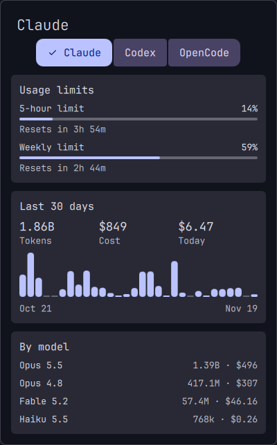
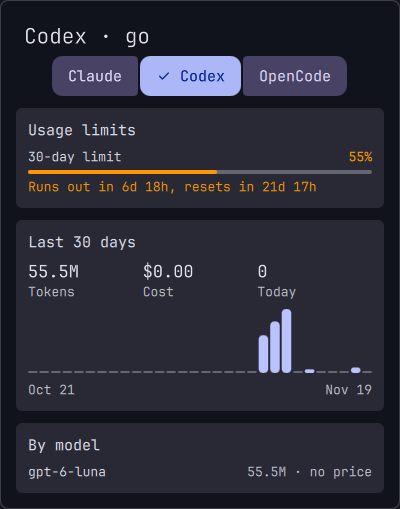
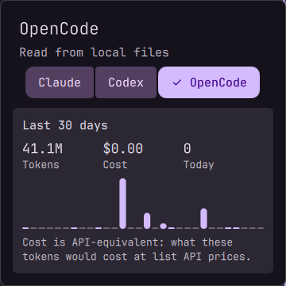
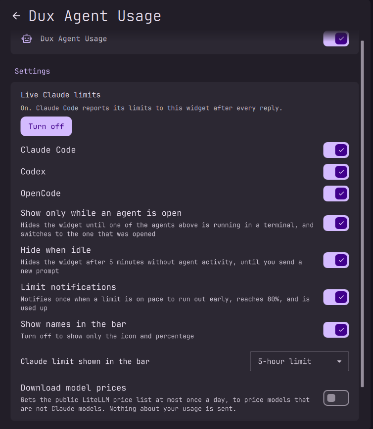

# Dux Agent Usage

A [DMS](https://duxlabs.dev) bar widget that shows your Claude Code, Codex and OpenCode usage: rate
limits, tokens and what the same usage would cost at API prices.

Everything is read from files on your computer. The widget never opens a credential file. Its colors
adapt to DMS's active theme, including light and dark themes.

## Screenshots

<p align="center">
  
  
  
</p>

## What you see

- **In the bar:** the agent's logo and how much of its limit is used. OpenCode has no limits, so it
  shows today's tokens or cost.
- **In the popout:** a switcher between agents, each limit with its reset time, a warning when a limit
  will run out before it resets, tokens and cost for the last 30 days, and a bar per day.
- **Notifications** when a limit is on pace to run out early, reaches 80%, and is used up.

By default the widget only appears while an agent is open in a terminal and has been active in the
last 5 minutes. Both rules can be turned off in the settings.

Right-click the widget to refresh it now.

## Requirements

- DMS 2.1 or later
- `python3` (standard library only)
- Linux (`ps` and `/proc`)

## Install

```bash
git clone https://github.com/Wasiq2006/dux-agent-usage.git ~/.config/dms/plugins/agentUsage
dms restart
dms ipc plugins enable agentUsage
```

Then add **Dux Agent Usage** to a bar section in Settings > Widgets.

## Live Claude limits

Claude Code does not write its limits to disk as you work. To get them live, open the plugin's settings
and choose **Turn on** under "Live Claude limits". This adds one entry to `~/.claude/settings.json`:

```json
"statusLine": {
  "type": "command",
  "command": "python3 ~/.config/dms/plugins/agentUsage/statusline.py"
}
```

Claude Code then runs `statusline.py` after every reply. The script saves the limits for the widget
and prints a short line such as `5h 54% · 7d 15%` in Claude Code's status bar.

- If you already have a custom status line, the plugin leaves it alone. Pipe the same JSON into
  `statusline.py` from your own script to feed the widget.
- The limits appear after the first reply of a session, and only for Claude subscription plans.
- Without this step the widget falls back to the copy Claude Code saves when you open `/usage`,
  which is usually out of date.

## Settings

| Setting | Default | What it does |
|---|---|---|
| Live Claude limits | off | Adds or removes the status line entry described above |
| Claude Code / Codex / OpenCode | on | Which agents the widget shows |
| Show only while an agent is open | on | Hides the widget until an agent is running in a terminal |
| Hide when idle | on | Hides the widget after 5 minutes without activity, until the next prompt |
| Limit notifications | on | The three notifications listed above |
| Show names in the bar | on | Off shows only the logo and number |
| Claude limit shown in the bar | 5-hour | 5-hour or weekly |
| Download model prices | off | See "Cost" below |



## What it reads

| Agent | Source | Used for |
|---|---|---|
| Claude Code | `~/.claude/projects/**/*.jsonl` (and `~/.claude-*`) | Tokens, cost |
| Claude Code | The status line data, or `cachedUsageUtilization` in `~/.claude.json` | Limits |
| Codex | `~/.codex/sessions/**/rollout-*.jsonl` | Tokens, cost, limits |
| OpenCode | `~/.local/share/opencode/opencode.db` (read-only) | Tokens, cost |

`CLAUDE_CONFIG_DIR`, `CODEX_HOME`, `XDG_DATA_HOME` and `XDG_CACHE_HOME` are respected. Only token
counts, model names and dates are kept, in `~/.cache/dms-agent-usage/`. No conversation text is stored.

Claude limits come from Claude Code on this computer. Usage from the desktop app or another device
shows up with the next Claude Code reply here.

## Cost

"API-equivalent cost" is what your tokens would cost at list API prices. On a subscription it is not
what you were charged.

- **Claude:** Anthropic's published prices, built in (checked 2026-11-14).
- **OpenCode:** the cost OpenCode itself records.
- **Codex and other models:** unpriced until you turn on "Download model prices". That fetches the
  public [LiteLLM](https://github.com/BerriAI/litellm) price list at most once a day. It is the
  plugin's only network request and sends nothing about your usage.

## Tests

```bash
python3 -m unittest discover -s tests
```

## Credits

Token counting and the pace warning follow [agent-meter](https://github.com/azannw/agent-meter).

The Claude, OpenAI and OpenCode logos are trademarks of their owners and are used only to identify
each tool. The icon files are from [Simple Icons](https://simpleicons.org).

## License

MIT
